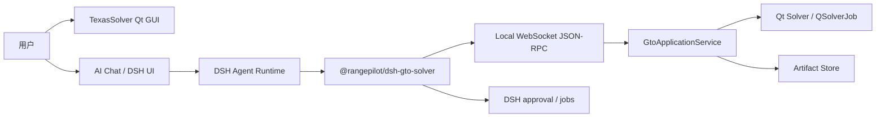

# RangePilot

RangePilot 是一个面向德州扑克 GTO 研究的 AI Agent 工作台。它保留原始开源
GTO Solver 的 Qt GUI 和操作方式，通过本地 WebSocket API 与 DSH 插件把求解器
能力安全地交给 Agent，并用 Chat 完成牌局配置、求解控制、结果解读和 GUI 定位。

当前版本已经完成一个可运行的 MVP：

- Qt/C++ Solver GUI 与本地 WebSocket JSON-RPC API；
- GTO 状态读取、牌局写入、异步求解、结果查询和 artifact；
- DSH Cordis 插件：5 个 GTO tools、后台 job、审批和预算控制；
- Qt ACP Chat：真实 DSH ACP v1 stdio 接入、Markdown 渲染、工具状态和审批；
- 真实 DeepSeek 模型端到端验收；
- 一键演示启动脚本。

> 仓库中的 `engines/dsh` 始终保持上游源码不变。GTO 接入位于树外插件
> `plugins/dsh-gto-solver`，不是对 DSH 核心的 fork。

## 1. 直接演示 MVP

### 前置条件

- Windows；
- Qt 5.15.2；当前构建使用 MSVC 2017；
- Node.js；
- `engines/dsh` 依赖已安装；
- 一个可用的 DeepSeek API Key。

当前演示脚本默认使用：

```text
qmake: D:\conda\Library\bin\qmake.exe
DSH:   engines/dsh/apps/cli/src/bin.ts
Node:  从 PATH 查找，或设置 RANGEPILOT_NODE
```

### 配置 Key

复制示例文件，填入本地 Key：

```powershell
copy .env.example .env
```

`.env` 已被 `.gitignore` 忽略，不会进入 Git。也可以直接在启动进程前设置
`DEEPSEEK_API_KEY` 环境变量。

### 构建并启动

```powershell
powershell -ExecutionPolicy Bypass -File scripts\build-mvp-demo.ps1
scripts\run-mvp-demo.cmd
```

启动器会：

1. 拉起带 Local API 的 `TexasSolverGui`；
2. 创建被忽略的 `.demo/dsh-home` DSH 环境；
3. 将 `plugins/dsh-gto-solver` 安装到 `acp` profile；
4. 启动真实 DSH ACP 子进程；
5. 打开独立浮动的 `AI Chat` 窗口。

启动成功后 Chat 顶部应显示：

```text
Connected; session ...
No active tool call
```

### 建议演示流程

```text
读取当前 GTO 状态，告诉我 revision、positions 和 board。
```

```text
OOP 范围 AA KK，IP 范围 AA AKs AKo QQ，其他设置默认，迭代 10 次后求解；
出现审批时等我确认。
```

```text
查询 root 节点的策略摘要，用 Markdown 表格展示动作、频率和 EV。
```

## 2. 已实现能力

### GTO 本地 API

- WebSocket + JSON-RPC 2.0，仅绑定 `127.0.0.1`；
- 每次启动生成随机 token，写入 discovery 文件；
- `system.hello` 握手；
- `state.get`、`spot.validate`、`range.validate`、`spot.set`；
- `solve.start`、`solve.getStatus`、`solve.cancel`、`solve.getSummary`；
- `result.getNodeStrategy`、`result.getActionEv`、`result.getExploitability`；
- `artifact.getMetadata`；
- `ui.focusNode`、`ui.openResult`；
- `state_changed`、`selection_changed` 和求解生命周期事件。

完整契约见 [`apps/gto-gui/api/schema/`](apps/gto-gui/api/schema/)，
说明见 [GTO Local API](docs/gto-local-api.md)。

### DSH 插件

`plugins/dsh-gto-solver` 是独立的 Cordis 插件，注入 `tools` 和 `jobs`：

- `gto_get_state`
- `gto_set_spot`
- `gto_start_solve`
- `gto_get_solve_status`
- `gto_query_strategy`

求解启动前通过 `tools/pre-execute` 做 revision、预算和单任务检查，并返回
`ask` 审批。DSH job 与 GTO job 建立映射，支持进度、超时和取消。

详见 [DSH GTO 插件](docs/dsh-plugin.md)。

### Qt Chat

- ACP v1 over stdio；
- `initialize`、`session/new`、`session/prompt`、`session/update`；
- `session/request_permission`、`session/cancel`、`session/close`；
- 流式消息、Markdown 渲染、自动滚动；
- 工具名称与状态展示；
- 允许/拒绝审批弹窗；
- 独立浮动窗口，避免被主界面挤压。

## 3. 架构



关键边界：

- **GUI 是唯一状态源**；API 不直接操作控件，而是通过
  `GtoApplicationService` 读写状态；
- **API 不知道 DSH、Agent、LLM 或 Chat**；
- **插件不知道 Qt 控件细节**，只使用稳定的 Local API；
- **DSH 源码不需要修改**；
- 写操作使用 `expectedRevision` 做乐观并发控制；
- 完整策略矩阵进入 artifact，Agent 只拿动作级摘要。

更完整的组件和时序说明见 [架构文档](docs/architecture.md)。

## 4. 仓库结构

| 路径 | 说明 |
|---|---|
| `apps/gto-gui/` | Qt/C++ Solver GUI submodule，包含 Local API 和 Qt Chat |
| `apps/gto-gui/api/schema/` | JSON-RPC 契约的唯一事实来源 |
| `apps/gto-gui/src/api/` | WebSocket Server、JSON-RPC、应用服务、DTO、artifact |
| `apps/gto-gui/src/chat/` | ACP client 和 Qt Chat 面板 |
| `apps/gto-gui/tests/api/` | API 契约测试与 WebSocket smoke test |
| `engines/dsh/` | DSH Agent Runtime submodule，保持上游不变 |
| `plugins/dsh-gto-solver/` | 树外 Cordis 插件：工具、job、审批 |
| `scripts/` | 构建与一键演示脚本 |
| `docs/` | 当前实现文档；历史设计文档在 `docs/history/` |

## 5. 开发与测试

### GUI 构建

```powershell
cd apps/gto-gui
qmake TexasSolverGui.pro
nmake
```

### API 契约测试

```powershell
cd apps/gto-gui
python tests/api/test_contracts.py
```

### API WebSocket smoke test

```powershell
mkdir build-api-test
cd build-api-test
qmake ../tests/api/api_smoke_test.pro
nmake
release\api_smoke_test.exe
```

### Qt Chat smoke tests

```powershell
# ACP client 协议测试
cd apps/gto-gui
qmake tests/chat/chat_smoke_test.pro
nmake

# ChatPanel offscreen 测试
qmake tests/chat/chat_panel_smoke_test.pro
nmake
```

### DSH 插件测试

```powershell
cd plugins/dsh-gto-solver
node --experimental-strip-types --test tests/*.test.ts
```

当前插件测试为 **10/10 通过**。测试矩阵和真实模型验收记录见
[测试与验收](docs/testing.md)。

## 6. 安全边界

- API 只监听本机回环地址；
- 客户端必须使用 discovery 文件中的随机 token 完成握手；
- 写入和求解必须携带 revision；
- 求解受最大迭代数、线程数、运行时间和目标 exploitability 限制；
- 求解启动需要 DSH 审批；
- `.env`、`.demo/`、`build/` 都不进入 Git；
- 不在源码或文档中写入真实 API Key。

## 7. 当前限制

- Qt Chat 是 MVP 级客户端，不是完整 DSH UI 替代品；
- 插件尚未声明 `dsh.bundle`，安装后仍需写入 profile 的
  `cordis.patch.yml`；
- `ui.focusNode` / `ui.openResult` 已在 API 层实现，但尚未封装成 DSH tool；
- artifact 文件持久化在本地，进程内元数据索引尚未持久化；
- DSH 源码模式启动仍会出现未构建 `lib/typert.host.js` 的非阻塞警告；
- 尚未制作安装包和正式分发流程；
- DSH Web UI 作为替代交互界面的方案仍在评估中。

## 8. 文档

- [文档索引](docs/README.md)
- [当前架构](docs/architecture.md)
- [GTO Local API](docs/gto-local-api.md)
- [DSH GTO 插件](docs/dsh-plugin.md)
- [MVP 演示指南](docs/mvp-demo.md)
- [测试与验收](docs/testing.md)
- [路线图与限制](docs/roadmap.md)
- [仓库 Agent 上下文](AGENTS.md)

## 9. 拉取仓库

~~~powershell
git clone --recurse-submodules https://github.com/maces622/RangePilot.git
cd RangePilot
~~~

已经 clone 但未初始化 submodule：

~~~powershell
git submodule update --init --recursive
~~~

## 10. 项目状态

RangePilot 已进入真实端到端验证完成阶段。
真实模型、DSH、GUI Local API 和 GTO solve 的完整链路已经跑通。
当前重点是改善交互体验、标准化插件安装、完善结果持久化。
后续需要决定主入口使用 Qt 内嵌 Chat 还是 DSH 原生 Web UI。
