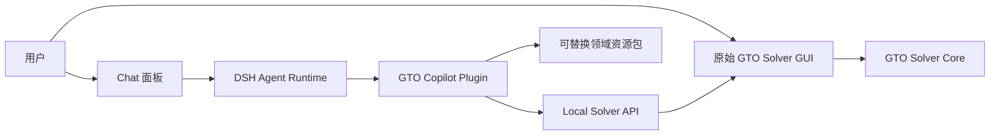

# RangePilot

RangePilot 是一个早期项目，目标是把开源 GTO Solver 的原始界面、Chat Agent 和 AI 分析能力整合成一个德州扑克研究工作台。

我们不想重写 Solver，也不想让用户离开熟悉的操作界面。RangePilot 希望在保留原始 GUI 使用习惯的基础上，让 Agent 能够理解当前牌局、代替用户完成部分 Solver 操作，并基于求解结果提供可解释的分析。

## 项目初衷

- 保留开源 GTO Solver 的原始界面和主要操作方式；
- 在界面中加入 Chat，让用户可以用自然语言完成配置、求解和结果解读；
- 使用 DSH（DeepSeek Harness）作为 Agent Runtime；
- 通过语义化 UI/API Bridge 操作 Solver，而不是依赖截图和坐标点击；
- 支持可替换的垂直领域资源包，例如现金局、锦标赛、不同牌类和训练资料；
- 保持 Solver、DSH 和领域资源之间的边界清晰，避免业务逻辑互相污染。

## 项目状态

项目目前处于设计和原型阶段，尚未达到可日常使用的程度。

当前重点是先把 GTO Solver 的能力以稳定、可测试的方式暴露出来，再逐步接入 Chat 和 Agent 工作流。

## 本地 API（阶段 5）

阶段 5 提供默认关闭的本地 API，使用 WebSocket + JSON-RPC 2.0：

```bash
TexasSolverGui --api-enabled --api-port 0
```

启动后服务只在 `127.0.0.1` 监听，并将会话发现信息写入
`%LOCALAPPDATA%\RangePilot\gto-gui\api.json`。客户端读取端口和 token 后连接
`ws://127.0.0.1:<port>/rpc`，先调用 `system.hello`，再调用 `state.get`。
可用 capability 为 `state.read`、`spot.write`、`solve.control`、`result.read`、`artifact.read` 和 `ui.focus`。阶段 5 支持牌局校验/写入、异步求解控制、节点策略/EV/exploitability/artifact 查询，以及 GUI 结果面板打开、节点聚焦和 `event.selection_changed`。写操作必须携带 `expectedRevision`，版本冲突返回 `STATE_CONFLICT`；完整策略矩阵通过 artifact 引用返回，不进入 JSON-RPC 响应正文。

接口契约位于 `apps/gto-gui/api/schema/`，测试位于 `apps/gto-gui/tests/api/`。

## 架构愿景



核心原则：

- Solver GUI 是宿主；
- DSH 是 Agent 引擎；
- Copilot 插件负责桥接；
- 领域资源包负责提供可替换的知识、技能、工具和评估集；
- Solver API 不依赖 DSH，未来可以更换 Agent 引擎。

## 仓库结构

| 路径 | 说明 |
|---|---|
| `apps/gto-gui` | 开源 GTO Solver GUI 的 Git submodule |`n| `apps/gto-gui/api/schema` | 本地 GTO API 的 JSON Schema 契约 |`n| `apps/gto-gui/src/api` | WebSocket Server、JSON-RPC、应用服务和事件 DTO |`n| `apps/gto-gui/tests/api` | API 契约测试与 WebSocket smoke test |
| `engines/dsh` | DSH Agent Engine 的 Git submodule |
| `plugins/dsh-gto-solver` | 树外 DSH Cordis 插件：GTO 工具、后台求解和审批 |
| `docs/gto-interface-exposure.md` | Solver 接口暴露技术方案 |
| `docs/` | 架构、设计和集成文档 |

## 拉取仓库

```bash
git clone --recurse-submodules https://github.com/maces622/RangePilot.git
cd RangePilot
```

如果已经 clone 但没有拉取 submodule：

```bash
git submodule update --init --recursive
```

## 路线图

1. 暴露原始 Solver 的只读状态接口；
2. 增加受 revision 保护的牌局配置接口；
3. 增加异步求解控制、进度事件和结果查询；
4. 接入 DSH Chat 和第一批 GTO 工具；
5. 支持可替换的垂直领域资源包和评估体系。

## 文档

- [GTO Solver 接口暴露技术方案](docs/gto-interface-exposure.md)
- [仓库 Agent 上下文](AGENTS.md)

## 说明

RangePilot 仍处于早期探索阶段，接口、目录和产品形态都可能继续调整。欢迎通过 Issue 讨论架构设计和使用场景。