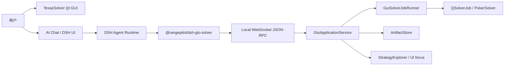
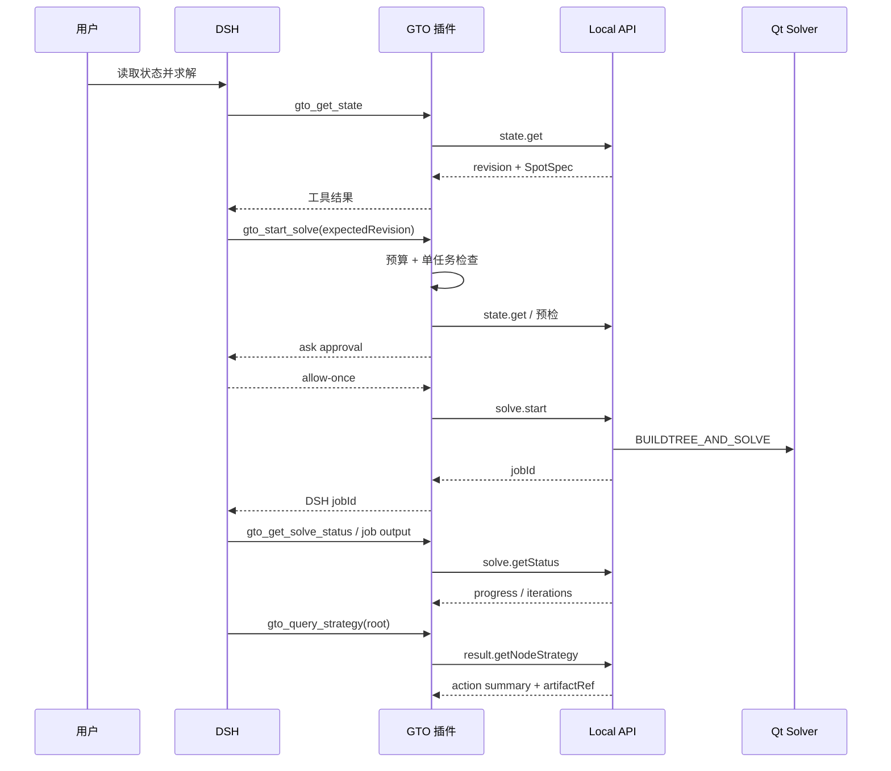

# RangePilot 架构

## 1. 目标

RangePilot 保留原始 Qt/C++ GTO Solver GUI，把 Solver 能力以稳定的本地 API
暴露给 Agent，并通过树外 DSH Cordis 插件接入工具调用、后台任务和审批。

架构目标：

- GUI 是 Solver 状态的唯一事实来源；
- Agent 使用语义 API，不依赖截图、坐标点击或 UI 自动化；
- API 不包含 DSH / LLM / Chat 概念，未来可替换 Agent Runtime；
- DSH 核心保持上游不变；
- 领域能力可以独立测试、独立安装、独立演化。

## 2. 进程与组件



| 组件 | 职责 |
|---|---|
| `apps/gto-gui` | Qt GUI、Solver 核心适配、Local API、ACP Chat |
| `GtoApplicationService` | 状态快照、Spot 校验/写入、revision、求解控制、结果和 UI 聚焦 |
| `GuiSolverJobRunner` | 把 `QSolverJob` 适配为 API JobManager 后端 |
| `GuiStrategyResultProvider` | 将 GameTree/Trainable 转为稳定 result DTO |
| `ArtifactStore` | 保存完整策略 JSON、SHA-256 和 artifact 引用 |
| `engines/dsh` | Agent Runtime，作为 Git submodule 保持上游提交 |
| `plugins/dsh-gto-solver` | 树外 Cordis 插件，注册 5 个 GTO tools、后台 job 和审批 |
| `apps/gto-gui/src/chat` | ACP v1 stdio client 和最小 Qt Chat 面板 |

## 3. 关键边界

### 3.1 GUI 与 API

API Server 不直接读取 Qt 控件。`MainWindow` 将当前 UI 状态同步到
`GtoApplicationService`，API 写入成功后由应用服务通知 GUI 回写规范化 Spot。

这样保证：

- API 与界面共享同一份领域状态；
- 不把控件树暴露给 Agent；
- Solver API 可以独立于 DSH 存在。

### 3.2 API 与 DSH

API 不知道 DSH、Agent、Prompt、Chat 或 LLM。它只定义：

- `state.read`
- `spot.write`
- `solve.control`
- `result.read`
- `artifact.read`
- `ui.focus`

DSH 侧的模型选择、会话、审批和 job 展示完全在插件和 Runtime 中。

### 3.3 DSH 与插件

`plugins/dsh-gto-solver` 注入：

```ts
export const inject = ['tools', 'jobs']
```

它通过 `ctx.tools.register` 注册工具，通过 `ctx.on('tools/pre-execute')`
拦截求解启动并返回审批，通过 `ctx.jobs` 管理后台求解。

DSH 核心不包含任何 GTO 条件分支，也不需要修改源码。

## 4. 一次完整请求的时序



## 5. 状态与并发

GUI 维护单调递增的 revision。

### 5.1 Revision

GUI 维护单调递增的 revision。所有写操作必须携带 expectedRevision：
- `spot.set`
- `solve.start`
- UI 内部修改状态后也会推进 revision

revision 不匹配返回 `STATE_CONFLICT`，服务端不做隐式 merge。这样防止 Agent
在用户已经修改牌局后覆盖新状态。

### 5.2 SpotSpec

`SpotSpec` 是完整牌局描述：

- gameType / mode
- positions
- effectiveStackBb
- blinds / pot / board
- OOP/IP ranges
- 各街 bet sizing
- allinThreshold
- useIsomorphism / useHalfFloats

写操作返回 `normalizedSpot`，GUI 和 API 使用同一份规范化结果。

### 5.3 求解任务状态

~~~text
queued -> running -> completed
                 -> failed
queued/running -> cancelling -> cancelled
~~~

同一时间只允许一个活动 GTO solve。`solve.start` 会先根据 SpotSpec 构建或重建
GameTree，再进入训练，因此 API 不需要调用方额外执行 Build Tree。

## 6. 结果与 Artifact

节点策略 API 只返回动作级摘要：

- action name
- frequency
- EV
- comboCount
- exploitability
- artifactRef

完整策略矩阵写入 JSON artifact，元数据包含：

~~~text
artifactId
uri = artifact://<jobId>/<artifactId>
mimeType
sizeBytes
sha256
createdAt
~~~

文件默认保存在：

~~~text
%LOCALAPPDATA%\RangePilot\gto-gui\artifacts
~~~

这样可以控制 Agent 上下文大小，同时保留完整结果用于 GUI 展示和后续分析。

## 7. UI Focus

`ui.focusNode(jobId, nodeId)` 让 GUI 打开 Strategy Explorer 并定位到指定节点。
节点 ID 使用稳定路径：

~~~text
root
root/a0
root/a0/cAh/a1
~~~

`ui.openResult(jobId)` 打开该次求解的结果视图。失败返回结构化错误，例如
`RESULT_NOT_READY` 或 `NODE_NOT_FOUND`。

这不是 Computer Use：不识别屏幕、不模拟鼠标，只调用 GUI 内部的语义接口。

## 8. 失败与安全

- API 只监听 `127.0.0.1`；
- 启动时生成随机 token；
- 客户端先完成 `system.hello`；
- 输入由 JSON Schema 和 DTO 双重校验；
- 求解受迭代、线程、运行时间和 exploitability 下限约束；
- DSH 审批策略为 `ask`；
- 任务失败保留结构化错误，不伪造成功状态；
- `.env` 和演示环境不进入 Git。

## 9. 当前未完成

- 插件尚未声明 `dsh.bundle`，profile 激活仍需手工 patch；
- `ui.focusNode` / `ui.openResult` 尚未包装成 DSH tool；
- artifact 元数据索引只在当前进程内；
- DSH 源码启动存在 typert 构建警告；
- Qt Chat 与 DSH Web UI 的最终主入口尚未定案。
