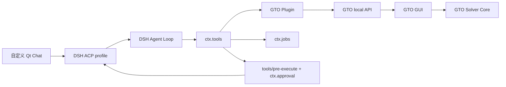
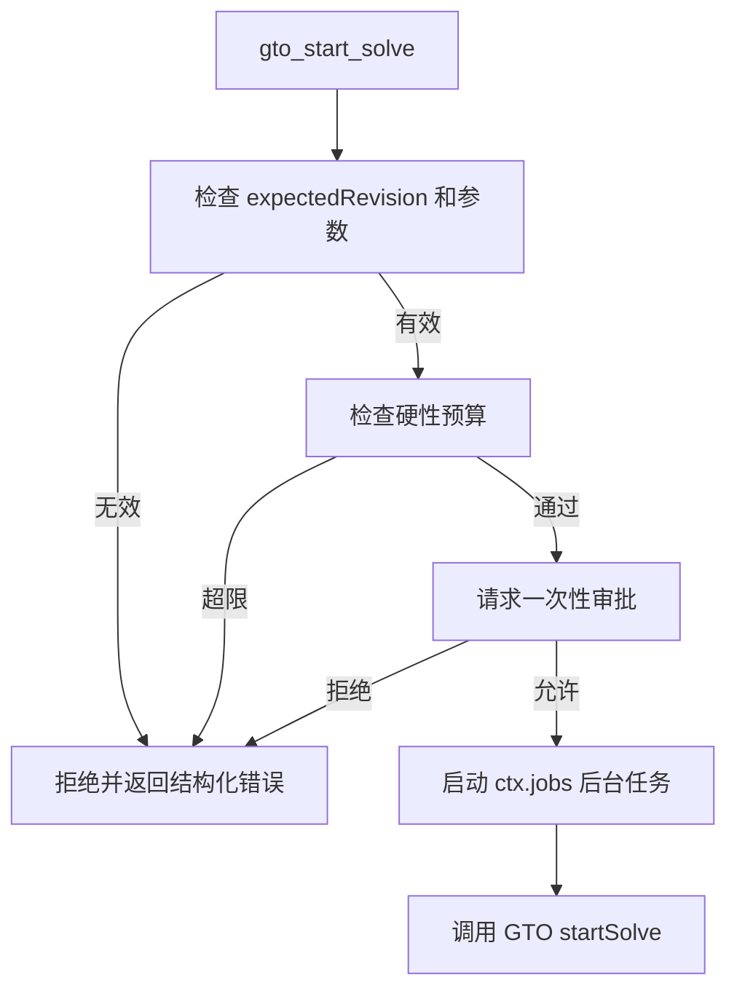
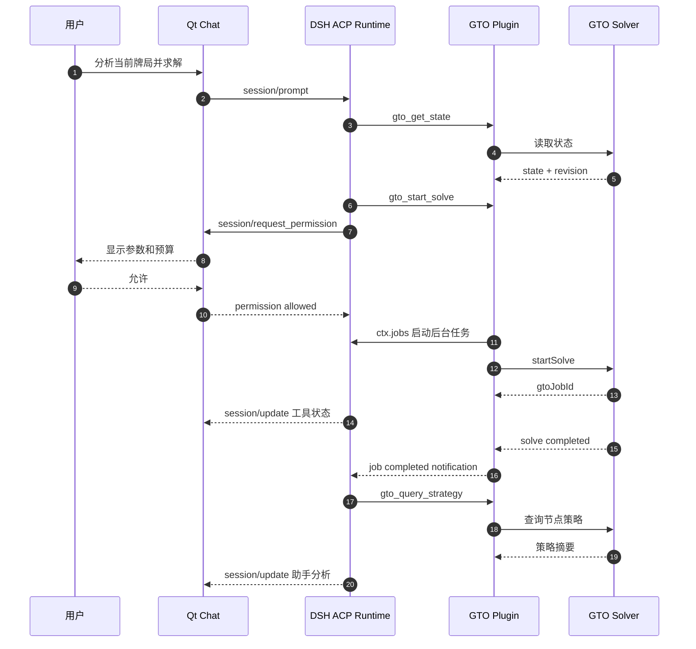
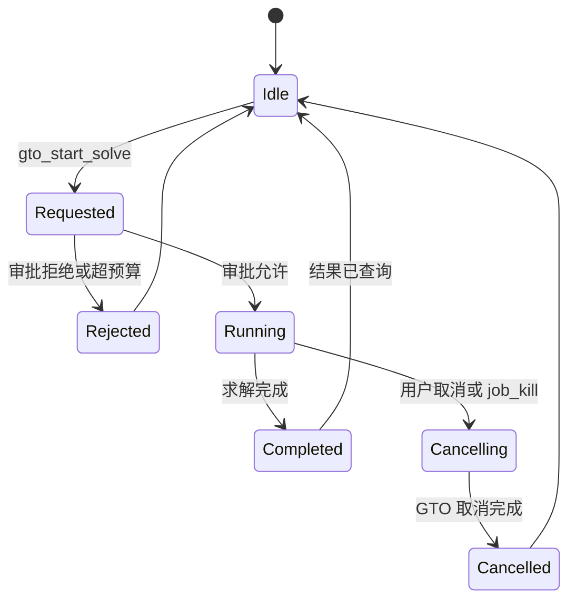

# DSH 侧最小 MVP 设计

| 项目 | 内容 |
|---|---|
| 文档状态 | MVP 设计 |
| 适用仓库 | GTO-Agent |
| DSH 目录 | `engines/dsh` |
| GTO GUI 目录 | `apps/gto-gui` |
| 目标 | 用 DSH 作为 Agent Runtime，通过自定义 Qt Chat 操作 GTO Solver |

## 1. 已确认决策

本 MVP 只实现以下内容：

1. 保留 `apps/gto-gui` 的原始 Solver GUI；
2. Chat 使用自定义 Qt 面板，不使用 DSH Web UI；
3. Qt Chat 通过 DSH 的可编程客户端接口接入 DSH；
4. DSH 通过 GTO 插件调用 `apps/gto-gui` 暴露的本地接口；
5. GTO 操作以 DSH 工具形式提供；
6. 求解使用 DSH 后台任务，不阻塞 Agent 轮次；
7. 求解前必须经过成本审批；
8. 禁止使用 browser-use 和 computer-use；
9. 不在 MVP 中实现远程服务、多用户、多 Solver 实例和复杂 Agent 编排。

## 2. MVP 范围

### 2.1 包含

- 一个 DSH GTO 插件；
- 五个 GTO 工具；
- 一个后台求解任务；
- 一次求解一次审批；
- 一个 ACP 会话；
- 一个 Qt Chat 面板；
- 纯文本消息流和工具状态展示；
- 允许、拒绝和取消求解。

### 2.2 不包含

- DSH Web UI 嵌入；
- browser-use；
- computer-use；
- 截图识别和坐标点击；
- 多 Agent 或 subagent；
- MCP；
- 自定义 UI 卡片；
- 领域资源包热替换；
- 远程 DSH 部署；
- 多用户权限；
- 多 Solver 实例。

## 3. 总体架构

职责边界：

| 组件 | 职责 |
|---|---|
| Qt Chat | 输入、消息流、审批弹窗、取消按钮 |
| ACP profile | Qt 与 DSH 的进程边界 |
| DSH Agent Loop | 模型轮次、工具调用和上下文 |
| GTO Plugin | GTO 工具、GTO API 客户端、后台任务 |
| GTO local API | 暴露 Solver 状态和语义操作 |
| GTO GUI | 唯一的 Solver 状态源 |

### 3.1 协议与插件边界

MVP 中有两条不同的链路，不能混用：

| 链路 | 协议 | 实现 | 是否 DSH 插件 |
|---|---|---|---|
| Qt Chat ↔ DSH | ACP JSON-RPC over stdio | Qt ACP 客户端 | 否 |
| DSH ↔ GTO 插件 | Cordis 插件接口 | `plugins/dsh-gto-solver` | 是 |
| GTO 插件 ↔ GTO GUI | 本地 WebSocket + JSON-RPC | GTO API Client + GTO Local API | 否 |

GTO Local API 的形式由 [GTO Solver 接口暴露技术方案](gto-interface-exposure.md) 定义。DSH 侧不重复定义 GTO 接口，也不直接访问 Qt 控件或 C++ 对象。

### 3.2 哪一部分是 DSH 插件

| 部分 | 是否 DSH 插件 | 说明 |
|---|---|---|
| GTO GUI 的 Local API Server | 否 | `apps/gto-gui` 的应用内接口 |
| GTO GUI 的 UI Bridge | 否 | 属于 Qt GUI |
| `plugins/dsh-gto-solver` | 是 | 原生 Cordis 插件 |
| 自定义 Qt Chat | 否 | ACP 客户端 |
| MCP Server | 否 | MVP 不实现 |

### 3.3 为什么 MVP 不使用 MCP

MCP 适合把 GTO 能力暴露给多个 Agent 或外部客户端，但当前 MVP 使用 DSH 原生插件：

- 原生插件可以直接注册 `ctx.tools`；
- 可以直接使用 `ctx.jobs` 管理长时间求解；
- 可以使用 `tools/pre-execute` 和 `ctx.approval` 完成求解审批；
- 可以访问 DSH 的会话、事件和工具执行流水线；
- 不需要额外维护一层 MCP Server 和 MCP Client 配置。

MCP 只在后续需要让 GTO 能力被 DSH 之外的客户端复用时再增加，不属于 MVP。
## 4. Qt Chat 与 DSH 的接入协议

MVP 使用 DSH 的 `acp` profile。

选择 ACP 而不是 SDK JSON-RPC 的原因：

- ACP 提供 `session/prompt`、`session/cancel` 和 `session/close`；
- ACP 提供 `session/request_permission`，可以承载求解前的交互式审批；
- ACP 提供 `session/update`，可以流式接收助手消息和工具生命周期；
- 当前 DSH SDK JSON-RPC 没有逐会话取消，也没有交互式审批通道。

Qt 通过 `QProcess` 启动 DSH ACP profile。stdout 只承载 JSON-RPC 协议，stderr 用于诊断日志。

最小调用顺序：

1. Qt 启动 DSH ACP 进程；
2. Qt 发送 `initialize`；
3. Qt 创建 `session/new`；
4. 用户输入通过 `session/prompt` 提交；
5. Qt 消费 `session/update`；
6. DSH 发起 `session/request_permission` 时，Qt 显示允许或拒绝；
7. 用户取消时，Qt 发送 `session/cancel`；
8. Qt 关闭时发送 `session/close` 并回收进程。
## 5. GTO 插件

插件目录：

| 路径 | 职责 |
|---|---|
| `plugins/dsh-gto-solver/package.json` | 插件包定义 |
| `plugins/dsh-gto-solver/src/index.ts` | 插件入口 |
| `plugins/dsh-gto-solver/src/gto-client.ts` | 调用 GTO local API |
| `plugins/dsh-gto-solver/src/tools/get-state.ts` | 读取 Solver 状态 |
| `plugins/dsh-gto-solver/src/tools/set-spot.ts` | 设置牌局 |
| `plugins/dsh-gto-solver/src/tools/start-solve.ts` | 启动后台求解 |
| `plugins/dsh-gto-solver/src/tools/get-solve-status.ts` | 查询求解状态 |
| `plugins/dsh-gto-solver/src/tools/query-strategy.ts` | 查询节点策略 |
| `plugins/dsh-gto-solver/src/jobs/solve-job.ts` | 求解后台任务 |
| `plugins/dsh-gto-solver/src/policy/solve-approval.ts` | 成本门禁和审批 |
| `plugins/dsh-gto-solver/tests/` | 工具、审批和任务测试 |

插件是原生 DSH Cordis 插件，作为树外插件安装到 DSH 的 `acp` profile。MVP 不修改 `engines/dsh` 核心。

插件只依赖一个 GTO 客户端接口。GTO local API 的传输细节由 `docs/gto-interface-exposure.md` 定义，插件不直接依赖 Qt 类型。

GTO 客户端至少需要：

- 读取当前状态；
- 设置牌局；
- 启动求解；
- 查询任务状态；
- 取消求解；
- 查询节点策略。

## 6. MVP 工具

| 工具 | 类型 | 说明 |
|---|---|---|
| `gto_get_state` | 只读 | 读取当前牌局、revision、选中节点和求解状态 |
| `gto_set_spot` | 写操作 | 带 `expectedRevision` 设置牌局 |
| `gto_start_solve` | 后台任务 | 经过审批后启动求解，返回 DSH job handle |
| `gto_get_solve_status` | 只读 | 查询进度、迭代次数和 exploitability |
| `gto_query_strategy` | 只读 | 查询指定节点的动作频率和 EV 摘要 |

### 6.1 工具约束

- 所有工具使用 `defineTool` 定义类型化输入输出；
- 工具不返回完整策略树，只返回摘要；
- 写操作必须携带 `expectedRevision`；
- 求解工具不得阻塞 Agent 轮次；
- 大结果通过 artifact 引用或后续查询获取；
- 工具错误必须使用结构化错误，而不是把异常文本直接交给模型。

### 6.2 `gto_start_solve`

`gto_start_solve` 只做三件事：

1. 校验求解参数；
2. 通过 `tools/pre-execute` 和 `ctx.approval` 完成一次审批；
3. 通过 `ctx.jobs.start()` 启动后台任务，并立即返回任务句柄。

后台任务的执行内容：

1. 调用 GTO local API 的 `startSolve`；
2. 轮询 `getSolveStatus`；
3. 将进度写入 job output；
4. 完成时返回 `jobId`、最终状态和结果摘要；
5. 取消时调用 GTO local API 的 `cancelSolve`。
## 7. 后台任务规则

- 同一时间只允许一个求解任务；
- 任务必须有明确的所有者，即发起工具调用的 Agent；
- 任务 ID 使用 `ctx.jobs` 返回的 DSH job ID；
- GTO Solver 自身返回的 jobId 作为任务 payload 字段单独保存；
- 任务完成时通过 DSH 的 session 内通知送达；
- Agent 收到完成通知后，再调用 `gto_get_solve_status` 或 `gto_query_strategy`；
- 用户取消时，DSH job 被终止，生产方负责调用 GTO 的取消接口；
- DSH 进程退出时，所有运行中的 GTO 任务必须被取消。

## 8. 成本审批

只有 `gto_start_solve` 需要交互式审批。读取和查询工具默认允许。

`tools/pre-execute` 的门禁流程：

审批要求：

- 每次求解单独审批，不记住上一次的允许；
- 审批内容至少包含牌局、下注尺度、迭代上限、预计资源和目标 exploitability；
- 审批超时按拒绝处理；
- 没有审批应答方时按拒绝处理；
- 用户拒绝后不得调用 GTO 求解接口；
- 审批只能放行本次 `gto_start_solve` 调用。

硬性预算至少包括：

- 最大迭代次数；
- 最大运行时间；
- 最大线程数；
- 同时运行任务数必须为 1；
- 超出预算直接拒绝，不进入审批。

## 9. 关键时序

## 10. Qt Chat 最小界面

Qt Chat 只实现：

- 消息列表；
- 文本输入框；
- 发送按钮；
- 停止按钮；
- 审批弹窗；
- 工具调用状态行；
- Solver 求解进度文本。

不实现：

- 自定义结果图表；
- 自定义 DSH ConversationNode；
- 内嵌浏览器；
- 多会话切换；
- 会话历史管理界面；
- 富文本或 Markdown 渲染之外的复杂组件。

Qt 需要处理的 ACP 消息：

| 消息 | 处理 |
|---|---|
| `initialize` | 建立协议连接 |
| `session/new` | 创建单个聊天会话 |
| `session/prompt` | 发送用户输入 |
| `session/update` | 更新助手文本和工具状态 |
| `session/request_permission` | 弹出允许或拒绝对话框 |
| `session/cancel` | 停止按钮 |
| `session/close` | 关闭窗口时清理会话 |

## 11. 错误处理

- DSH 进程启动失败：Qt 显示启动错误并禁用聊天输入；
- ACP 协议断线：Qt 标记会话不可用，并提示重启；
- 工具返回 `STATE_CONFLICT`：Agent 重新读取状态后再决定是否重试；
- 求解参数非法：直接返回结构化校验错误，不进入审批；
- 审批拒绝：返回 `solve_rejected`，不得启动任务；
- GTO Solver 崩溃：后台任务失败，Agent 不自动重试；
- 用户取消：后台任务进入 `cancelling`，调用 GTO 取消接口后结束；
- DSH 进程退出：Qt 清理子进程和未完成的 UI 状态。

## 12. 安全边界

- Qt 不直接调用 GTO Solver 内部函数；
- DSH 插件不直接操作 Qt 控件；
- 插件只调用 GTO local API；
- 不暴露 shell、任意文件路径、browser-use 或 computer-use；
- GTO local API 只监听本机；
- 插件不接收或记录模型 API Key；
- 模型凭据由 DSH profile 管理；
- 求解审批必须在 GTO 调用之前完成；
- 同一时间只允许一个求解任务。

## 13. MVP 验收标准

1. Qt 能启动 DSH ACP profile 并完成 `initialize`；
2. 用户能在自定义 Qt Chat 中发送一条消息并看到流式助手文本；
3. Agent 能调用 `gto_get_state` 读取当前牌局；
4. Agent 能调用 `gto_set_spot` 修改牌局，并检测 revision 冲突；
5. Agent 调用 `gto_start_solve` 时，Qt 弹出审批窗口；
6. 用户拒绝审批时，GTO Solver 不会启动求解；
7. 用户允许审批后，DSH 创建后台任务并显示求解进度；
8. 求解完成后，Agent 能调用 `gto_query_strategy` 返回节点摘要；
9. 用户停止时，DSH job 和 GTO 求解都被取消；
10. 项目中没有启用 browser-use 或 computer-use；
11. 插件工具通过 schema 测试、审批测试和后台任务测试。

## 14. 明确禁止

- 禁止使用 browser-use；
- 禁止使用 computer-use；
- 禁止截图点击 Solver GUI；
- 禁止让模型直接生成并执行 Solver 命令；
- 禁止把完整策略树返回给模型；
- 禁止绕过 `tools/pre-execute` 启动求解；
- 禁止在审批拒绝后继续调用 GTO 求解接口。

## 15. MVP 完成后的下一步

本 MVP 完成后再讨论：

- 领域资源包；
- 自定义结果卡片；
- MCP；
- subagent；
- 多会话；
- 会话持久化 UI；
- 更细的成本预估。

在这些能力被确认之前，不加入本设计。