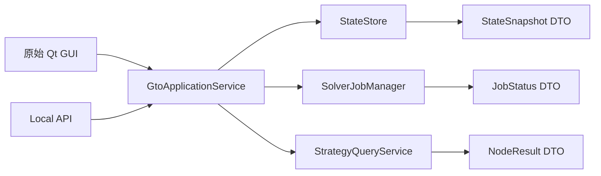
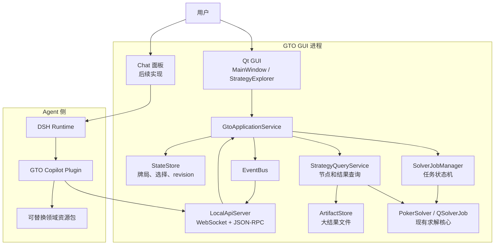
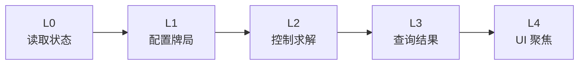
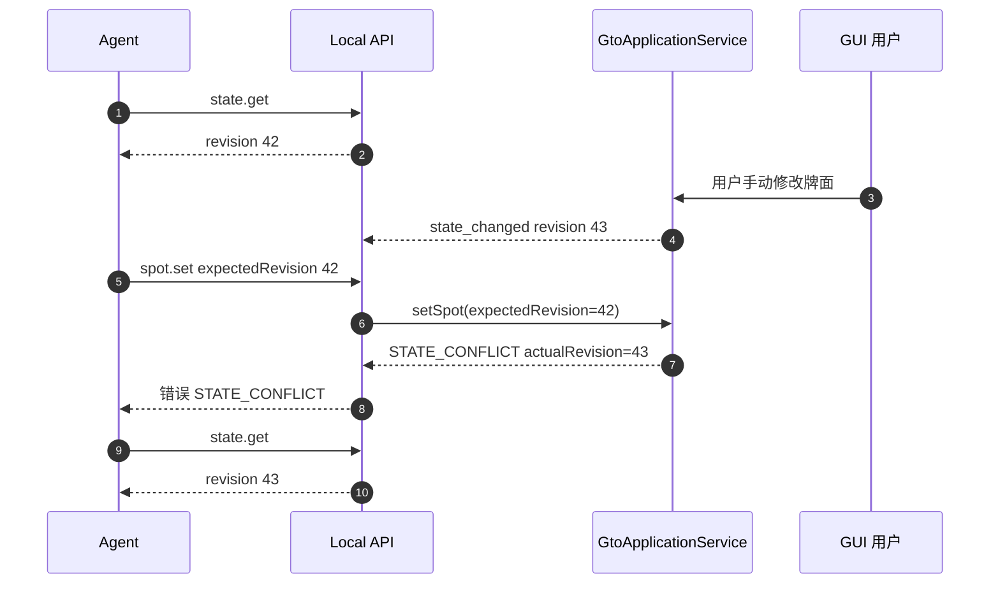
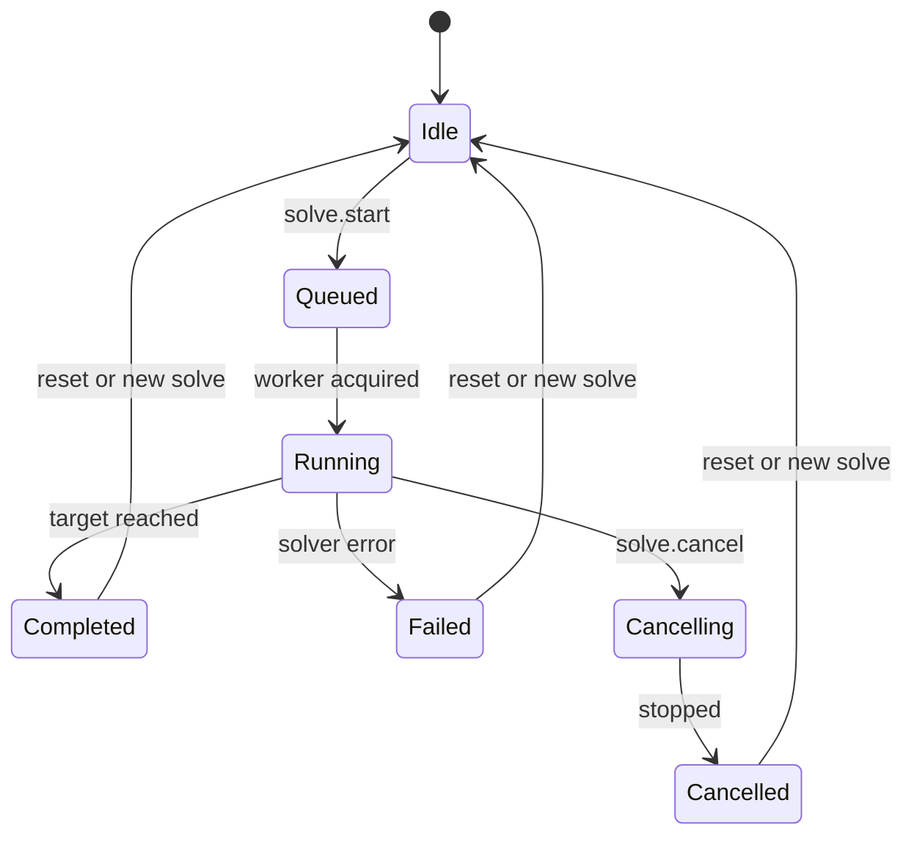
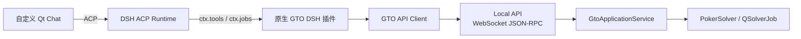
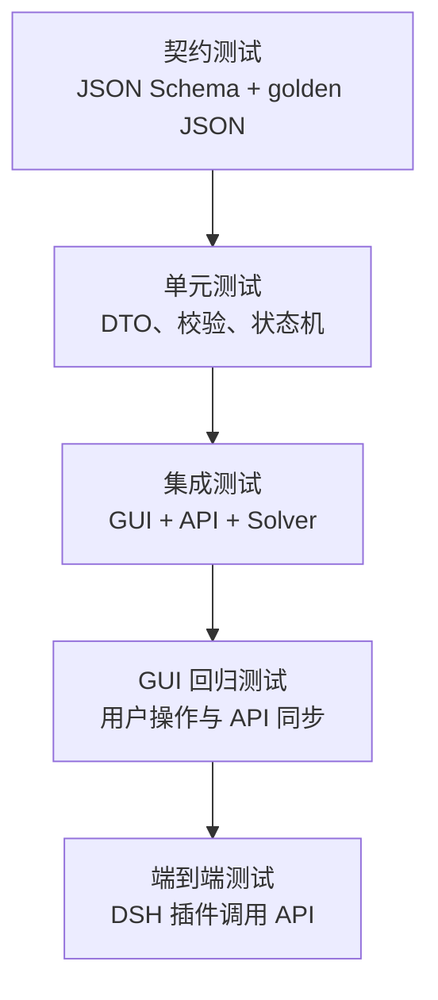

# GTO Solver 接口暴露技术方案

| 项目 | 内容 |
|---|---|
| 文档状态 | 设计草案 v0.1 |
| 所属仓库 | GTO-Agent |
| 主要涉及目录 | `apps/gto-gui`、`engines/dsh` |
| 目标 | 先暴露 GTO Solver 的稳定能力接口，为后续 Chat、DSH Agent 和可替换领域资源包提供基础 |
| 协议方向 | 本地 WebSocket + JSON-RPC 2.0 |

## 1. 摘要

当前产品形态、Agent 能力边界和 Chat 工作流尚未完全确定，因此第一阶段不把 Agent 行为固化进 Solver。

本方案先完成以下事情：

1. 将原始 Qt GUI 中的 Solver 状态和操作抽取为统一应用服务；
2. 在同一进程内增加只监听本机的 API Server；
3. 通过语义化命令暴露读取状态、配置牌局、启动求解、查询结果等能力；
4. 通过事件流推送状态变化和求解进度；
5. 通过 artifact 引用传递大结果，避免大数组进入 Agent 上下文；
6. 保持 DSH 与 Solver API 解耦，DSH 只是一个普通客户端。

核心结论：

> 先暴露能力原语，不提前固化 Agent 工作流。

## 2. 当前代码基线

### 2.1 关键文件

| 文件 | 现有职责 | 对本方案的意义 |
|---|---|---|
| `apps/gto-gui/main.cpp` | 创建 `QApplication` 和 `MainWindow` | 后续在这里解析 API 启动参数并创建 API Server |
| `apps/gto-gui/mainwindow.h` | `MainWindow` 持有 `QSolverJob`、范围选择器、结果浏览器等 | GUI 状态和操作的主要入口 |
| `apps/gto-gui/mainwindow.cpp` | 从 UI 控件读取参数并启动求解 | 需要逐步改为调用统一应用服务 |
| `apps/gto-gui/include/runtime/qsolverjob.h` | `QSolverJob` 继承 `QThread`，包含 LOADING、SOLVING、BUILDTREE、SAVING 等任务 | 现有求解任务执行器，可作为 JobManager 的底层 |
| `apps/gto-gui/include/runtime/PokerSolver.h` | 构建 GameTree、训练、停止、导出策略 | Solver 核心能力入口 |
| `apps/gto-gui/strategyexplorer.h` | 打开结果窗口、浏览节点和策略 | 结果查询和 UI 聚焦的主要参考 |
| `apps/gto-gui/include/ui/tablestrategymodel.h` | 组织策略、EV、范围等结果数据 | 可复用的结果读取和转换逻辑 |
| `apps/gto-gui/src/api.cpp` | 现有 headless C API，接收输入文件、资源目录和模式 | 可复用于无界面求解，但不足以表达 GUI 当前状态 |
| `apps/gto-gui/resources/ffi_api/python_ctypes.py` | 通过 ctypes 调用 `api.dll` | 证明已有 headless 调用路径，可作为核心 API 参考 |
| `apps/gto-gui/TexasSolverGui.pro` | Qt qmake 工程文件 | 需要增加 `network` 和 `websockets` 模块 |

### 2.2 现有架构特点

- GUI 控件直接持有和修改求解参数；
- `MainWindow` 创建并持有 `QSolverJob`；
- `QSolverJob` 以线程方式执行任务，并通过日志控件输出过程信息；
- 策略结果通过 `GameTree`、`ActionNode`、`Trainable` 和 `TableStrategyModel` 等结构读取；
- 现有 `api.cpp` 是面向输入文件的 headless API，不是面向 GUI 当前状态的应用 API。

因此不能直接把 `api.cpp` 当成最终接口，需要在其上增加一层应用状态和命令服务。

## 3. 目标与非目标

### 3.1 目标

- GUI 和 API 共用同一份应用状态；
- 外部客户端可以读取当前牌局、选中节点和求解状态；
- 外部客户端可以通过语义命令修改牌局配置；
- 求解任务异步执行，支持进度事件和取消；
- 结果查询返回结构化摘要，完整数据通过 artifact 引用；
- 写操作支持 revision 冲突检测；
- API 与 DSH 完全解耦；
- 可以按 capability 逐步开放权限；
- 接口可通过 JSON Schema 做契约测试。

### 3.2 非目标

本阶段暂不实现：

- Chat 面板；
- Agent Prompt 和技能；
- 自然语言意图解析；
- 完整的 AI 分析工作流；
- 公网远程 API；
- 多用户权限系统；
- 云端求解集群；
- 基于截图和坐标的 UI 自动化。
## 4. 设计原则

### 4.1 GUI 是唯一状态源

不能出现 GUI 状态、API 状态和 Agent 状态三套副本。


GUI 和 API 都调用同一个应用服务。Agent 永远不直接维护一份它以为的 Solver 状态。

### 4.2 语义操作优先

不暴露鼠标坐标、键盘事件、任意 shell 或任意文件路径。应该暴露：设置牌局、校验范围、启动求解、查询节点策略、取消任务和聚焦结果节点。

### 4.3 读写分离

- 读操作通过 `state.get` 和 `result.*`；
- 写操作必须携带 `expectedRevision`；
- 求解是长任务，必须通过 `jobId` 异步跟踪；
- 大结果通过 artifact 获取。

### 4.4 Contract First

先在 `apps/gto-gui/api/schema/` 定义 JSON Schema，再实现 C++ DTO、API Server 和客户端。第一阶段先实现 `system.hello`、`system.getCapabilities`、`state.get` 和 `event.state_changed`。

### 4.5 API 不知道 DSH

API 中不出现 `dsh`、`agent`、`prompt`、`chat`、`llm` 等概念。DSH 集成层负责把 API 包装成工具，未来替换 Agent 引擎时 Solver 不需要改动。
## 5. 总体架构



### 5.1 组件职责

| 组件 | 职责 | 不负责 |
|---|---|---|
| `LocalApiServer` | 连接、握手、JSON-RPC 分发、事件广播 | 业务状态和求解逻辑 |
| `GtoApplicationService` | 统一应用服务和命令编排 | UI 绘制、Agent 推理 |
| `StateStore` | 当前牌局、选择、revision | 求解算法 |
| `SolverJobManager` | 任务创建、状态机、取消、超时 | 自然语言理解 |
| `StrategyQueryService` | 从 GameTree / Trainable 读取策略和 EV | 修改 Solver 参数 |
| `ArtifactStore` | 大结果文件、哈希、生命周期 | 在 JSON 中传输完整结果 |
| `EventBus` | 状态变化、任务进度、错误事件 | 直接操作 GUI 控件 |
| `GTO Copilot Plugin` | DSH 工具映射、技能编排、结果解释 | 直接依赖 Qt 内部结构 |
## 6. 能力分级



| 级别 | Capability | 能力 |
|---|---|---|
| L0 | `state.read` | 读取牌局、选择节点、任务状态 |
| L1 | `spot.write` | 校验和设置牌面、位置、范围、下注尺度 |
| L2 | `solve.control` | 启动、查询、取消求解 |
| L3 | `result.read` | 查询策略、EV、exploitability 和 artifact |
| L4 | `ui.focus` | 让 GUI 聚焦到某个结果节点 |
| 实验 | `ui.automation` | 预留，不作为第一版目标 |

每个 capability 都应该能够独立关闭。

## 7. 传输协议

### 7.1 选择 WebSocket + JSON-RPC 2.0

推荐原因：

- Qt 提供 `QWebSocketServer`；
- 支持双向通信，适合求解进度和状态事件；
- DSH、Python、Node.js、浏览器都可以接入；
- 比纯 HTTP 轮询更适合长任务；
- 比 gRPC 更容易在现有 Qt 工程中落地；
- 比命名管道更容易调试和跨语言接入。

明确边界：本文定义的是 GTO GUI 自己的本地应用接口，**不是 MCP 接口**。MCP 只在后续需要把 GTO 能力开放给多个 Agent 或外部客户端时增加，不属于 MVP。

### 7.2 监听范围

API Server 只监听 `127.0.0.1`，禁止监听 `0.0.0.0` 或公网地址。

### 7.3 启动参数

建议新增：

```text
--api-enabled
--api-port <port>
--api-discovery-file <path>
```

`--api-port 0` 表示自动分配随机端口。

默认行为：

- 开发版可以通过参数开启；
- 正式版默认关闭，需要用户显式开启；
- API 与 GUI 使用同一进程；
- 不启动第二个 Solver 实例。

### 7.4 发现文件

随机端口和 token 写入当前用户的本地发现文件，例如：

```text
%LOCALAPPDATA%\RangePilot\gto-gui\api.json
```

示例内容：

```json
{
  "pid": 12345,
  "protocol": "gto-api/1.0",
  "port": 51423,
  "token": "per-process-random-token",
  "serverVersion": "0.1.0",
  "startedAt": "2026-01-01T12:00:00Z"
}
```

要求：文件仅当前用户可读；token 每次启动随机生成；token 不写入普通日志；PID 用于判断发现文件是否过期。
### 7.5 握手

客户端连接 `ws://127.0.0.1:<port>/rpc`，然后发送：

```json
{
  "jsonrpc": "2.0",
  "id": 1,
  "method": "system.hello",
  "params": {
    "protocol": "gto-api/1.0",
    "token": "per-process-random-token",
    "client": {
      "name": "dsh",
      "version": "0.1.0"
    }
  }
}
```

服务端响应：

```json
{
  "jsonrpc": "2.0",
  "id": 1,
  "result": {
    "protocol": "gto-api/1.0",
    "sessionId": "session-uuid",
    "server": {
      "name": "TexasSolverGui",
      "version": "0.1.0",
      "commit": "abc1234"
    },
    "capabilities": [
      "state.read",
      "spot.write",
      "solve.control",
      "result.read",
      "artifact.read",
      "ui.focus"
    ]
  }
}
```

## 8. API v1 方法

| 方法 | 类型 | Capability | 说明 |
|---|---|---|---|
| `system.hello` | 同步 | 无 | 握手、token 校验、协议协商 |
| `system.getCapabilities` | 同步 | 无 | 获取方法列表和限制 |
| `system.health` | 同步 | 无 | 健康检查 |
| `state.get` | 同步 | `state.read` | 获取当前状态快照 |
| `spot.validate` | 同步 | `spot.write` | 只校验，不修改 |
| `spot.set` | 同步 | `spot.write` | 替换当前牌局配置 |
| `range.validate` | 同步 | `spot.write` | 校验范围并返回规范化结果 |
| `solve.start` | 异步 | `solve.control` | 启动求解，立即返回 jobId |
| `solve.getStatus` | 同步 | `solve.control` | 查询任务状态 |
| `solve.cancel` | 同步 | `solve.control` | 取消任务 |
| `solve.getSummary` | 同步 | `result.read` | 获取结果摘要 |
| `result.getNodeStrategy` | 同步 | `result.read` | 查询节点策略和 EV |
| `result.getActionEv` | 同步 | `result.read` | 查询动作 EV |
| `result.getExploitability` | 同步 | `result.read` | 查询收敛信息 |
| `artifact.getMetadata` | 同步 | `artifact.read` | 获取大结果元数据 |
| `ui.focusNode` | 同步 | `ui.focus` | 聚焦 GUI 节点 |
| `ui.openResult` | 同步 | `ui.focus` | 打开结果面板 |
### 8.1 `state.get`

请求：

```json
{
  "jsonrpc": "2.0",
  "id": 2,
  "method": "state.get",
  "params": {}
}
```

响应：

```json
{
  "jsonrpc": "2.0",
  "id": 2,
  "result": {
    "revision": 42,
    "sessionId": "session-uuid",
    "screen": "strategy",
    "spot": {
      "gameType": "NLHE",
      "mode": "holdem",
      "positions": ["BTN", "BB"],
      "effectiveStackBb": 100,
      "blinds": [0.5, 1.0],
      "board": ["Ah", "Kd", "7c"],
      "ranges": {
        "BTN": "AA,KK,QQ",
        "BB": "AA,KK"
      }
    },
    "tree": {
      "rootNodeId": "root",
      "nodeCount": 12345
    },
    "solve": {
      "jobId": "job-001",
      "state": "completed",
      "progress": 1.0,
      "exploitability": 0.42
    },
    "selection": {
      "nodeId": "BTN_flop_check"
    }
  }
}
```

### 8.2 `spot.validate`

请求：

```json
{
  "jsonrpc": "2.0",
  "id": 3,
  "method": "spot.validate",
  "params": {
    "spot": {
      "gameType": "NLHE",
      "mode": "holdem",
      "positions": ["BTN", "BB"],
      "effectiveStackBb": 100,
      "board": ["Ah", "Kd", "7c"],
      "ranges": {
        "BTN": "AA,KK,QQ",
        "BB": "AA,KK"
      }
    }
  }
}
```

响应：

```json
{
  "jsonrpc": "2.0",
  "id": 3,
  "result": {
    "valid": true,
    "normalizedSpot": {},
    "warnings": []
  }
}
```

校验至少包括：board 牌数和格式、位置合法性、筹码和下注尺度、范围可解析性、范围组合数限制、重复牌和模式支持情况。
### 8.3 `spot.set`

写操作必须带 `expectedRevision`：

```json
{
  "jsonrpc": "2.0",
  "id": 4,
  "method": "spot.set",
  "params": {
    "expectedRevision": 42,
    "spot": {
      "gameType": "NLHE",
      "mode": "holdem",
      "positions": ["BTN", "BB"],
      "effectiveStackBb": 100,
      "board": ["Ah", "Kd", "7c"],
      "ranges": {
        "BTN": "AA,KK,QQ",
        "BB": "AA,KK"
      }
    }
  }
}
```

成功响应：

```json
{
  "jsonrpc": "2.0",
  "id": 4,
  "result": {
    "revision": 43,
    "normalizedSpot": {}
  }
}
```

版本冲突：

```json
{
  "jsonrpc": "2.0",
  "id": 4,
  "error": {
    "code": -32010,
    "message": "State revision conflict",
    "data": {
      "code": "STATE_CONFLICT",
      "expectedRevision": 42,
      "actualRevision": 43
    }
  }
}
```

不要做隐式 merge。Agent 应重新读取状态，再决定是否重试。

### 8.4 `solve.start`

```json
{
  "jsonrpc": "2.0",
  "id": 5,
  "method": "solve.start",
  "params": {
    "expectedRevision": 43,
    "options": {
      "maxIterations": 200,
      "targetExploitability": 0.5,
      "threads": 8,
      "algorithm": "discounted_cfr"
    }
  }
}
```

响应：

```json
{
  "jsonrpc": "2.0",
  "id": 5,
  "result": {
    "jobId": "job-001",
    "state": "queued"
  }
}
```

该调用不能阻塞等待求解完成。

### 8.5 `solve.getStatus`

```json
{
  "jsonrpc": "2.0",
  "id": 6,
  "method": "solve.getStatus",
  "params": {
    "jobId": "job-001"
  }
}
```

响应：

```json
{
  "jsonrpc": "2.0",
  "id": 6,
  "result": {
    "jobId": "job-001",
    "state": "running",
    "progress": 0.37,
    "iterations": 74,
    "exploitability": 1.24,
    "elapsedMs": 18000
  }
}
```
### 8.6 `result.getNodeStrategy`

```json
{
  "jsonrpc": "2.0",
  "id": 7,
  "method": "result.getNodeStrategy",
  "params": {
    "jobId": "job-001",
    "nodeId": "BTN_flop_check",
    "actions": ["check", "bet_33", "bet_75"],
    "limit": 100
  }
}
```

响应：

```json
{
  "jsonrpc": "2.0",
  "id": 7,
  "result": {
    "nodeId": "BTN_flop_check",
    "actions": [
      {
        "action": "check",
        "frequency": 0.62,
        "ev": 2.31
      },
      {
        "action": "bet_33",
        "frequency": 0.31,
        "ev": 2.28
      }
    ],
    "exploitability": 0.42,
    "artifactRef": "artifact://job-001/node/BTN_flop_check"
  }
}
```

完整策略矩阵不进入 JSON 响应正文。

## 9. 状态、并发与事件

### 9.1 Revision

每次状态变化递增 `revision`：API 写操作成功、GUI 用户操作成功、求解状态变化和当前结果节点变化。写操作必须携带读取时的 revision。

### 9.2 冲突处理流程



### 9.3 求解任务状态机


### 9.4 事件类型

| 事件 | 说明 |
|---|---|
| `event.state_changed` | 牌局、选择或 revision 变化 |
| `event.solve_queued` | 求解任务进入队列 |
| `event.solve_progress` | 迭代次数、进度和 exploitability |
| `event.solve_completed` | 求解完成 |
| `event.solve_failed` | 求解失败 |
| `event.solve_cancelled` | 求解取消 |
| `event.selection_changed` | 当前结果节点变化 |
| `event.server_shutdown` | Solver 即将退出 |

事件示例：

```json
{
  "jsonrpc": "2.0",
  "method": "event.solve_progress",
  "params": {
    "jobId": "job-001",
    "progress": 0.37,
    "iterations": 74,
    "exploitability": 1.24
  }
}
```

事件要求：带单调递增的 `sequence`；进度事件最多每 100ms 推送一次；客户端断线后通过 `state.get` 恢复；大数组不通过事件推送；事件不替代请求响应，客户端仍可主动查询。

## 10. 数据模型

### 10.1 SpotSpec

| 字段 | 类型 | 说明 |
|---|---|---|
| `gameType` | string | 例如 `NLHE` |
| `mode` | string | `holdem` 或 `shortdeck` |
| `positions` | string[] | 例如 `["BTN", "BB"]` |
| `effectiveStackBb` | number | 有效筹码 |
| `blinds` | number[] | 小盲和大盲 |
| `pot` | number | 初始底池或当前底池 |
| `board` | string[] | 公共牌 |
| `ranges` | object | 玩家到范围字符串的映射 |
| `betSizing` | object | flop、turn、river 的下注和加注尺度 |
| `allinThreshold` | number | 全下阈值 |
| `useIsomorphism` | boolean | 是否使用同构优化 |
| `useHalfFloats` | boolean | 是否使用半精度优化 |

### 10.2 SolveOptions

| 字段 | 类型 | 说明 |
|---|---|---|
| `maxIterations` | integer | 最大迭代次数 |
| `targetExploitability` | number | 目标 exploitability |
| `threads` | integer | 求解线程数 |
| `algorithm` | string | 求解算法 |
| `printInterval` | integer | 日志间隔 |
| `dumpRounds` | integer | 导出轮数 |

### 10.3 JobStatus

| 字段 | 类型 | 说明 |
|---|---|---|
| `jobId` | string | 任务 ID |
| `state` | string | queued、running、completed、failed、cancelled |
| `progress` | number | 0 到 1 |
| `iterations` | integer | 当前迭代次数 |
| `exploitability` | number | 当前 exploitability |
| `startedAt` | string | ISO 时间 |
| `finishedAt` | string | ISO 时间 |
| `error` | object | 失败信息 |
### 10.4 ArtifactRef

| 字段 | 类型 | 说明 |
|---|---|---|
| `artifactId` | string | artifact ID |
| `uri` | string | 例如 `artifact://job-001/node/...` |
| `mimeType` | string | 数据类型 |
| `sizeBytes` | integer | 文件大小 |
| `sha256` | string | 内容哈希 |
| `createdAt` | string | 创建时间 |

## 11. DSH 接入方式

### 11.1 采用原生 DSH 插件，不采用 MCP

MVP 的 DSH 接入形式确定为原生 Cordis 插件：

- 插件注册 `ctx.tools`；
- 求解通过 `ctx.jobs` 以后台任务运行；
- 求解前通过 `tools/pre-execute` 和 `ctx.approval` 审批；
- 插件内部使用 GTO API Client 调用本文定义的本地 JSON-RPC API。

不使用 MCP 作为 MVP 主接口。MCP 适合把 GTO 能力开放给多个 Agent 或外部客户端，但当前 DSH 原生插件可以直接使用工具注册、后台任务、审批和会话上下文，少一层协议适配。



Qt Chat 与 DSH 之间使用 ACP，DSH 插件与 GTO GUI 之间使用本文定义的 WebSocket JSON-RPC。两条链路不要混为同一个协议。

### 11.2 插件边界

| 部分 | 是否 DSH 插件 | 说明 |
|---|---|---|
| `apps/gto-gui` 的 Local API Server | 否 | GTO GUI 的应用内接口 |
| `GtoApplicationService` | 否 | Solver 内部统一状态和命令服务 |
| `plugins/dsh-gto-solver` | 是 | DSH 原生 Cordis 插件 |
| 自定义 Qt Chat | 否 | DSH ACP 客户端 |
| MCP Server | 否 | MVP 不实现，后续可选 |

DSH 插件负责：

- 注册 GTO 工具；
- 调用 GTO local API；
- 管理 `ctx.jobs` 后台求解任务；
- 执行 `tools/pre-execute` 成本门禁；
- 调用 `ctx.approval` 请求用户确认；
- 把 Solver 结果整理成模型可见摘要。

DSH 插件不负责：

- 绘制或修改 Qt GUI；
- 直接调用 `PokerSolver` 或 `QSolverJob`；
- 直接操作 GUI 控件；
- 管理模型凭据；
- 定义 Qt 与 DSH 之间的 Chat 协议。

### 11.3 MVP 工具清单

工具名使用 DSH 常见的 snake_case；底层 API 方法仍使用点号命名空间。

| DSH 工具 | 底层 API | 说明 |
|---|---|---|
| `gto_get_state` | `state.get` | 读取当前牌局、revision 和任务状态 |
| `gto_set_spot` | `spot.set` | 写入牌局配置 |
| `gto_start_solve` | `solve.start` | 经审批后启动后台求解 |
| `gto_get_solve_status` | `solve.getStatus` | 查询进度和收敛状态 |
| `gto_query_strategy` | `result.getNodeStrategy` | 查询节点策略和 EV 摘要 |

`gto_start_solve` 必须经过 `tools/pre-execute` 和 `ctx.approval`。取消由 DSH 后台任务控制路径触发，生产方在取消时调用 GTO API 的取消接口。

完整 MVP 设计见 [DSH 侧最小 MVP 设计](dsh-side-mvp.md)。

## 12. C++ 实现方案

### 12.1 新增文件

| 路径 | 职责 |
|---|---|
| `apps/gto-gui/src/api/api_server.h/.cpp` | WebSocket Server、连接和事件广播 |
| `apps/gto-gui/src/api/rpc_dispatcher.h/.cpp` | JSON-RPC 方法路由和错误转换 |
| `apps/gto-gui/src/api/protocol.h/.cpp` | 协议常量、错误码、序列化辅助 |
| `apps/gto-gui/src/api/dto/` | API DTO |
| `apps/gto-gui/src/api/services/gto_application_service.h/.cpp` | 统一应用服务 |
| `apps/gto-gui/src/api/services/state_store.h/.cpp` | 状态和 revision |
| `apps/gto-gui/src/api/services/solver_job_manager.h/.cpp` | 任务状态机 |
| `apps/gto-gui/src/api/services/strategy_query_service.h/.cpp` | 策略和 EV 查询 |
| `apps/gto-gui/src/api/services/artifact_store.h/.cpp` | artifact 管理 |
| `apps/gto-gui/src/api/events/event_bus.h/.cpp` | 事件分发 |
| `apps/gto-gui/api/schema/` | JSON Schema |
| `apps/gto-gui/tests/api/` | 契约测试和集成测试 |
| `docs/gto-interface-exposure.md` | 本文档 |

### 12.2 Qt 工程修改

在 `TexasSolverGui.pro` 中增加：

```qmake
QT += network websockets
```

并将新增的 `src/api` 文件加入 `SOURCES` 和 `HEADERS`。如果当前 Qt SDK 没有 WebSockets 模块，需要先安装对应组件。

### 12.3 GtoApplicationService

```cpp
class GtoApplicationService : public QObject {
    Q_OBJECT

public:
    StateSnapshot getState() const;

    ValidationResult validateSpot(const SpotSpec& spot);
    Result<Revision> setSpot(const SpotSpec& spot, Revision expected);

    Result<JobId> startSolve(const SolveOptions& options, Revision expected);
    Result<void> cancelSolve(const JobId& jobId);
    JobStatus getJobStatus(const JobId& jobId) const;

    Result<NodeResult> queryNodeStrategy(
        const JobId& jobId,
        const NodeSelector& selector
    );

signals:
    void stateChanged(Revision revision, const QStringList& changedPaths);
    void solveProgress(const JobStatus& status);
    void solveCompleted(const JobStatus& status);
    void solveFailed(const JobStatus& status, const ApiError& error);
    void selectionChanged(const NodeId& nodeId);
};
```
### 12.4 从现有代码抽取

建议按以下顺序改造：

1. `MainWindow` 不再直接读取散落的 UI 字段来启动任务；
2. 增加 `SpotSpec` 和 `SolveOptions` 作为参数对象；
3. `MainWindow` 的 UI 事件调用 `GtoApplicationService`；
4. `QSolverJob` 由 `SolverJobManager` 持有或由 `MainWindow` 注入；
5. 增加 `QSolverJob` 的状态和进度信号；
6. `StrategyExplorer` 和 `StrategyQueryService` 共用 GameTree 查询逻辑；
7. `LocalApiServer` 只依赖 `GtoApplicationService`，不依赖 `MainWindow`。

### 12.5 QSolverJob 需要补充的信号

当前 `QSolverJob` 主要通过日志控件输出过程信息。为了支持 API 事件，需要增加：

```cpp
signals:
    void missionStarted(QString jobId, int missionType);
    void missionProgress(
        QString jobId,
        double progress,
        int iteration,
        double exploitability
    );
    void missionFinished(QString jobId, bool success, QString error);
```

注意：`QSolverJob` 是 `QThread`，信号必须线程安全；进度不能通过直接操作 UI 控件来获取；取消操作要等待底层求解停止；同一时间只允许一个求解任务。

### 12.6 结果查询

结果查询建议复用 `PokerSolver::get_solver()`、`Solver::get_game_tree()`、`ActionNode`、`Trainable::getAverageStrategy()`、`Trainable::dump_evs()` 以及 `TableStrategyModel` 中的策略和 EV 组织逻辑。

`StrategyQueryService` 负责把 C++ 结构转换成稳定 DTO，而不是把内部对象直接序列化。

### 12.7 main.cpp 接入

建议使用 `QCommandLineParser` 解析：

```text
--api-enabled
--api-port
--api-discovery-file
```

然后在 `MainWindow` 创建后初始化 API Server，并注册到 `QApplication` 生命周期中。不要在 API Server 内创建第二个 `QApplication` 或第二个 Solver 实例。
## 13. 安全设计

### 13.1 本机访问

API Server 只监听 `127.0.0.1`，使用随机端口和每次启动随机 token。发现文件仅当前用户可读，token 不进入日志。

### 13.2 输入限制

- 最大范围字符串长度；
- 最大 board 牌数；
- 最大树节点数；
- 最大并发任务数；
- 最大运行时间；
- 最大结果文件大小；
- 最大事件频率。

### 13.3 路径限制

客户端不能传入任意文件路径。artifact 只能通过 ID 访问，artifact root 固定在应用数据目录，拒绝 `..`、绝对路径和符号链接逃逸。导出路径必须经过服务端校验。

### 13.4 禁止能力

默认不暴露：任意 shell 命令、任意文件读写、任意网络请求、直接操作 C++ 指针、直接调用 Qt GUI 控件、绕过 Solver 资源限制的求解参数。

## 14. 测试方案



### 14.1 单元测试

DTO 序列化和反序列化、Spot 校验、Range 解析、Revision 冲突、Job 状态机、错误码转换和 Artifact 路径检查。

### 14.2 契约测试

使用 `apps/gto-gui/api/schema/` 下的 JSON Schema 验证请求、响应、错误和事件格式，并检查协议版本兼容性。

建议保存以下 golden JSON：

| 文件 | 用途 |
|---|---|
| `tests/api/golden/hello.json` | 握手 |
| `tests/api/golden/state_get.json` | 状态读取 |
| `tests/api/golden/spot_set.json` | 牌局设置 |
| `tests/api/golden/solve_start.json` | 求解启动 |
| `tests/api/golden/solve_progress.json` | 求解进度 |
| `tests/api/golden/state_conflict.json` | 版本冲突 |
### 14.3 集成测试

- 启动 GUI 或 headless 模式；
- 客户端握手；
- 读取初始状态；
- 修改牌局；
- 启动小规模求解；
- 查询结果；
- 取消任务；
- 断开重连后恢复状态。

无显示器 CI 环境可以使用：

```text
QT_QPA_PLATFORM=offscreen
```

### 14.4 GUI 回归测试

确保 API 操作后 GUI 同步更新；用户手动操作后 API 能读到新状态；旧 revision 不会覆盖用户修改；连续操作不会造成状态损坏；求解取消后 GUI 和 API 状态一致。

## 15. 分阶段实施

| 阶段 | 范围 | 验收标准 |
|---|---|---|
| 阶段 0 | 代码调研和最小 WebSocket Server | 能启动、握手、收发一个 JSON-RPC 请求 |
| 阶段 1 | 只读 API | `state.get`、`event.state_changed` 可用，GUI 状态可被读取 |
| 阶段 2 | 牌局配置 API | `spot.validate`、`spot.set`、range 解析可用，revision 冲突正确 |
| 阶段 3 | 求解控制 API | 异步启动、状态查询、取消和进度事件可用 |
| 阶段 4 | 结果与 artifact | 节点策略、EV、exploitability 和 artifact 元数据可用 |
| 阶段 5 | UI 聚焦与 DSH 插件 | GUI 节点聚焦和第一批 DSH 工具可用 |

### 15.1 第一阶段最小验收

第一阶段只要求：API 默认关闭；通过启动参数开启；只监听 `127.0.0.1`；支持 token 握手；支持 `system.hello`；支持 `system.getCapabilities`；支持 `state.get`；支持 `event.state_changed`；不修改任何牌局和求解状态。

这是风险最低、最适合先验证产品方向的起点。
## 16. 主要风险

| 风险 | 影响 | 应对 |
|---|---|---|
| GUI 状态和控件强耦合 | 难以建立统一状态源 | 先抽 `GtoApplicationService` 和 `SpotSpec` |
| `QSolverJob` 任务生命周期不清晰 | 重复启动、取消失败 | 增加 JobManager 和明确状态机 |
| 求解进度目前主要通过日志 | API 无法结构化获取 | 给 `QSolverJob` 增加进度信号 |
| 结果结构复杂 | DTO 设计和性能风险 | 摘要 + artifact，分页查询 |
| API 暴露过度 | 安全风险 | capability 分级、输入限制、默认关闭 |
| 多实例端口冲突 | 客户端连错实例 | 随机端口 + 发现文件 + PID 校验 |
| 契约漂移 | DSH 客户端不兼容 | JSON Schema + golden tests |
| DSH 耦合 | 引擎不可替换 | Solver API 不包含 DSH 概念 |

## 17. 开放问题

在进入实现前需要确认：

1. 当前目标平台是否只考虑 Windows，还是需要 macOS/Linux；
2. 当前 Qt 版本是否包含 WebSockets 模块；
3. 是否允许修改 `QSolverJob` 的线程模型；
4. GUI 是否必须保持完全一致的布局，还是可以增加内部状态适配层；
5. 第一阶段是否只做只读 API；
6. DSH 接入已确定：使用原生 DSH 插件直接连接本地 WebSocket API，不引入 MCP；
7. artifact 第一版是否允许使用本地文件路径，还是必须通过本地 HTTP 服务；
8. 是否需要支持多个 Solver 实例；
9. 是否需要将 headless API 和 GUI API 合并为同一协议；
10. 领域资源包是否需要在第一阶段就定义 manifest。

## 18. 结论

第一阶段不建议直接开发完整 Chat 或 Agent 工作流。推荐顺序是：

1. 统一 Solver 应用状态；
2. 在 GUI 进程中提供本地只读 API；
3. 增加受 revision 保护的牌局配置 API；
4. 增加异步求解控制和事件流；
5. 增加结果查询和 artifact；
6. 最后由 DSH 插件把这些能力映射成 Agent 工具。

这样可以在产品形态尚未确定时，先建立一个稳定、可测试、可演进的 Solver 能力边界。后续无论 Chat 放在哪一侧、DSH 如何编排工具、领域资源包如何替换，都不需要反复改造 Solver 内部。

接口形式确定为本地 WebSocket + JSON-RPC 2.0，不使用 MCP。DSH 侧通过原生 Cordis 插件消费这些能力，Qt Chat 与 DSH 之间使用 ACP。